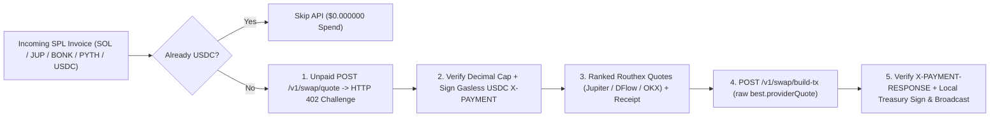

# InvoiceSweep x402 × Swap.io — Autonomous Solana Freelancer & Micro-DAO Invoice Auto-Settler

[](https://tunguyen1993.github.io/invoicesweep-swapio-x402/)
[-Release_v1.0.0-38BDF8?style=for-the-badge&logo=youtube)](https://github.com/tunguyen1993/invoicesweep-swapio-x402/releases/download/v1.0.0/swapio_x402_superteam_1080p.mp4)
[](https://swap.io)

> **Live Interactive Dashboard + Embedded 84s 1080p Video Player:**  
> **https://tunguyen1993.github.io/invoicesweep-swapio-x402/**
>
> **Companion Technical Deep-Dive Article (Medium / Editorial Edition):**  
> **https://tunguyen1993.github.io/invoicesweep-swapio-x402/article.html**
>
> **Direct 84s 1080p Pitch Video Download (`10,628,080` bytes · SHA-256 `c035e731cca6...`):**  
> **https://github.com/tunguyen1993/invoicesweep-swapio-x402/releases/download/v1.0.0/swapio_x402_superteam_1080p.mp4**
>
> **Try Swap.io & Hermes Agent API:**  
> **[https://swap.io](https://swap.io)** · **[https://hermes.swap.io/v1/info](https://hermes.swap.io/v1/info)** · **[Swap.io x402 Quickstart](https://docs.swap.io/developer-tools/agent-api-x402/quickstart)**

---

## 1. The Problem: SaaS API Subscriptions Punish Sporadic Solana Agents

Solana freelancers, smart-contract audit guilds, designers, and Micro-DAOs rarely get paid in a single asset. In a normal month, **5 to 10 client invoices** arrive across grants, bounties, and retainers denominated in volatile SPL tokens (**`SOL`**, **`JUP`**, **`BONK`**, **`PYTH`**) — while rent, contributor payroll, and tax reserves must be held in **`USDC`**.

Traditional DEX aggregator APIs force self-hosted bookkeeping agents into a bad trade-off:
- Pay **`$99.00/month`** (`$1,188/year`) for a recurring Pro API key that sits idle 99.9% of the month (`$12.37` in API overhead per swap at 8 invoices/month!), **or**
- Manage long-lived static `API_KEY` secrets in `.env` files that risk credential leaks.

**InvoiceSweep x402** solves this natively with **[Swap.io](https://swap.io)’s Hermes x402 Agent API (`https://hermes.swap.io`)**: the agent holds zero API keys, pays **`$0.000000`** when idle or when an invoice arrives directly in `USDC`, and settles fractions of a cent per swap over standard `HTTP 402 Payment Required`.

---

## 2. End-to-End `Swap.io x402` Protocol Architecture



### Key Protocol & Security Engineering Highlights

1. **Verbatim Live `hermes.swap.io` `HTTP 402` Inspection (`hermes_live_402_capture.json`):**
   - Captured live against `POST https://hermes.swap.io/v1/swap/quote` (`906` bytes, SHA-256 `23ddcdeb7906e298647af7b863d24c969c505ea6105848533daa5e8d06d09d14`).
   - Advertises `x402Version: 1`, `scheme: "exact"` across both **Solana SPL USDC** (`EPjFWdd5AufqSSqeM2qN1xzybapC8G4wEGGkZwyTDt1v`, `maxAmountRequired: "3007"` = `$0.003007 USDC`) and **Base EIP-3009 USDC** (`0x833589fCD6eDb6E08f4c7C32D4f71b54bdA02913`).
2. **Gasless API Micro-Payments (`extra.feePayer`):**
   - Swap.io’s facilitator (`2wKupLR9q6wXYppw8Gr2NvWxKBUqm4PPJKkQfoxHDBg4`) sponsors Solana network gas for the x402 payment itself — the dedicated agent API wallet only needs **USDC** and **zero SOL**.
3. **Inner `providerQuote` Contract & Cryptographic Receipts:**
   - Passes `best.providerQuote` (never the outer quote wrapper) into `POST /v1/swap/build-tx` and validates decoded base64 `X-PAYMENT-RESPONSE` (`success === true`) before handing the unsigned `VersionedTransaction` to the treasury signer.
4. **Zero Float Drift & Redirect Hardening:**
   - 100% fixed-point `Decimal` and integer-atomic math (`multiply before //` slippage bounds), `Retry-After` backoff with bounded jitter, and `ZeroTrustSameOriginRedirectHandler` host allowlisting (`hermes.swap.io`).

---

## 3. Unit Economics: `Swap.io x402` vs. Traditional `$99/mo` DEX API Plans

| Monthly Non-USDC Invoices | Swap.io x402 Quickstart Floor (`$0.0020/swap`) | Swap.io Live Routhex Rate (`$0.006007/swap`) | Traditional Pro DEX API Plan | Monthly Savings (`x402`) |
| :--- | :--- | :--- | :--- | :--- |
| **1 swap / mo** *(Solo Freelancer)* | `$0.002000` | `$0.006007` | `$99.00` | **`99.99%` (`$98.99/mo`)** |
| **8 swaps / mo** *(Typical Freelancer / Guild)* | **`$0.016000`** | **`$0.048056`** | `$99.00` | **`99.95% – 99.98%` (`~$1,187.81/yr`)** |
| **25 swaps / mo** *(Audit Collective)* | `$0.050000` | `$0.150175` | `$99.00` | **`99.85% – 99.95%`** |
| **150 swaps / mo** *(Active Micro-DAO)* | `$0.300000` | `$0.901050` | `$99.00` | **`99.09% – 99.70%`** |

> **Break-Even Threshold:** An autonomous agent would need **16,480 to 49,500 swaps every single month** before a flat `$99/mo` API key subscription beats **[Swap.io](https://swap.io)** `x402`.

---

## 4. Repository Structure & Local Verification

| File | Purpose |
| :--- | :--- |
| [`index.html`](./index.html) | Zero-dependency interactive web dashboard: 84s 1080p video showcase, incoming SPL invoice queue, live `402` payload inspector, 5-step protocol simulator, and unit-economics calculator |
| [`invoicesweep_x402_agent.py`](./invoicesweep_x402_agent.py) | Reference Python 3 agent: unpaid live `hermes.swap.io` `402` probe + deterministic `$0` mock facilitator end-to-end sweep (`quote` -> `build-tx` -> `X-PAYMENT-RESPONSE`) |
| [`test_invoicesweep_x402.py`](./test_invoicesweep_x402.py) | `11` unit & protocol invariant tests (`Decimal` atomic math, slippage floor, live `402` schema, `providerQuote` contract, receipt verification, SSRF/redirect shield) |
| [`hermes_live_402_capture.json`](./hermes_live_402_capture.json) | Verbatim production `HTTP 402` capture from `https://hermes.swap.io/v1/swap/quote` (`2026-11-10T04:28:07Z`, SHA-256 verified) |

### Run Locally (`$0` Spend)

```bash
# 1. Run deterministic end-to-end multi-SPL invoice sweep + unit economics report
python3 invoicesweep_x402_agent.py --capture-file hermes_live_402_capture.json

# 2. Perform a live $0 unpaid HTTP 402 discovery check against hermes.swap.io
python3 invoicesweep_x402_agent.py --live-402-check

# 3. Run the 11-test pytest suite
pytest test_invoicesweep_x402.py -v
```

---

## Links

- **Swap.io:** [https://swap.io](https://swap.io)
- **Hermes x402 API Info:** [https://hermes.swap.io/v1/info](https://hermes.swap.io/v1/info)
- **Live Interactive Showcase:** [https://tunguyen1993.github.io/invoicesweep-swapio-x402/](https://tunguyen1993.github.io/invoicesweep-swapio-x402/)
- **1080p Pitch Video Release (`v1.0.0`):** [https://github.com/tunguyen1993/invoicesweep-swapio-x402/releases/tag/v1.0.0](https://github.com/tunguyen1993/invoicesweep-swapio-x402/releases/tag/v1.0.0)
